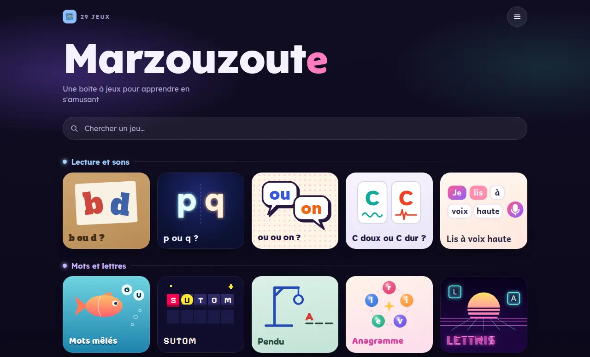

# Marzouzoute

**[Jouer à Marzouzoute](https://isc.github.io/marzouzoute/)**

Une boîte à jeux pour apprendre en s'amusant, pour les enfants et en français :
une trentaine de petits jeux de lecture, d'orthographe, de calcul et de logique,
et des jeux de plateau. Sans compte ni publicité, sur téléphone, tablette ou
ordinateur.

## Les jeux

| Famille            | Quelques jeux                                 |
| ------------------ | --------------------------------------------- |
| Lecture et sons    | b ou d ?, C doux ou C dur ?, Lis à voix haute |
| Mots et lettres    | Sutom, Pendu, Mots mêlés, Lettris             |
| Chiffres et calcul | Les amis de 10, Fracto Dingo, 2048            |
| Logique et réflexe | Mastermind, Démineur, Sudoku, Tetris          |
| Jeux de plateau    | Puissance 4, Othello, Dames, Qwirkle          |
| À plusieurs        | Time's Up, Tabou, Mölkky                      |

Le site s'installe comme une appli depuis le navigateur (« Ajouter à l'écran
d'accueil »), et les jeux déjà ouverts restent disponibles hors-ligne.

## Comment c'est fait

Du HTML, du CSS et du JavaScript natifs, sans framework, sans étape de build et
sans dépendance externe : chaque jeu est une page autonome, reliée depuis
[`index.html`](index.html). Les conventions à suivre pour ajouter ou modifier un
jeu sont dans [`CLAUDE.md`](CLAUDE.md).

Les contenus sont fabriqués par les scripts d'[`outils/`](outils) :

- `dictionnaire.txt` et `explications/` : d'après le lexique de Grammalecte et
  le Wiktionnaire, avec des définitions réécrites pour les enfants par Claude ;
- `audio/` : les mots dits par une voix de synthèse (Voxtral, de Mistral) ;
- `images/mots/` et `images/phrases/` : des dessins de Z-Image Turbo.

### PWA

- [`manifest.json`](manifest.json) : les métadonnées d'installation.
- [`service-worker.js`](service-worker.js) : le cache hors-ligne. La coquille de
  l'appli est précachée à l'installation, les pages passent d'abord par le réseau
  (_network-first_), et les autres ressources sont servies depuis le cache puis
  rafraîchies (_stale-while-revalidate_). `CACHE_VERSION` ne s'incrémente que pour
  forcer une purge immédiate après avoir modifié un asset précaché.

### Déploiement

Le site est publié sur GitHub Pages, depuis la branche `gh-pages` (dossier
`/ (root)`, à choisir une fois dans **Settings → Pages**).

- **`deploy.yml`** : à chaque push sur `main`, publie le dépôt à la racine de
  `gh-pages`, et ne passe au vert qu'une fois le site en train de servir ce commit.
- **`preview.yml`** : à chaque PR, déploie une preview isolée sous
  `previews/<branche>/` et commente la PR avec le lien.
- **`preview-cleanup.yml`** : supprime la preview à la fermeture de la PR.

Tous les chemins de l'appli sont relatifs : elle n'a besoin d'aucune réécriture
pour être servie sous un sous-dossier.

## Ajouter un jeu sans écrire de code

Un collaborateur ou une collaboratrice du dépôt peut faire ajouter un jeu par
Claude :

1. Ouvrir une **issue** avec le modèle _« 🎮 Nouveau jeu »_, qui décrit le jeu.
2. `claude-issue-to-pr.yml` déclenche Claude, qui écrit le jeu en suivant
   [`CLAUDE.md`](CLAUDE.md), ouvre une **PR** et poste son lien dans l'issue.
3. La **preview** de la PR se déploie : on y teste le jeu pour de vrai.
4. Pour demander des changements, commenter **`@claude …`** sur la PR : `claude.yml`
   relance Claude, et la preview se met à jour.
5. Le mainteneur relit et fusionne.

Une issue ou un `@claude` d'une personne extérieure au dépôt est ignoré : les
workflows ne se déclenchent que pour `OWNER`, `COLLABORATOR` et `MEMBER`.

### Mise en place (une fois)

1. **Installer l'[app GitHub Claude](https://github.com/apps/claude)** sur le
   dépôt (permissions Contents, Issues et Pull requests). Le `GITHUB_TOKEN` par
   défaut ne suffit pas : les PR qu'il crée ne déclenchent ni les previews ni la CI.
   La commande `/install-github-app` de Claude Code installe l'app et le secret
   d'un coup.
2. **Ajouter le secret** `CLAUDE_CODE_OAUTH_TOKEN`, avec la valeur que donne
   `claude setup-token` (abonnement Claude Pro ou Max).
3. **Inviter les contributeurs** comme collaborateurs, avec l'accès _write_.

Chaque exécution consomme des minutes GitHub Actions et le quota de l'abonnement
Claude, sans facturation à l'API. `--max-turns` borne les boucles.

## Licence

Le dépôt est sous licence [MIT](LICENSE), sauf ce qui vient d'ailleurs et garde
sa propre licence :

- [`dictionnaire.txt`](dictionnaire.txt) : lexique de
  [Grammalecte](https://grammalecte.net), MPL 2.0.
- [`explications/`](explications) : grammaire d'après Grammalecte (MPL 2.0) et
  définitions d'après le [Wiktionnaire](https://fr.wiktionary.org), réécrites
  pour les enfants (CC BY-SA 4.0).
- [`outils/definitions.json`](outils/definitions.json) : ces mêmes définitions
  (CC BY-SA 4.0).
- Les polices (`*.woff2`) : [SIL Open Font License 1.1](OFL.txt), sauf Luckiest
  Guy ([Apache 2.0](Apache-2.0.txt)).
